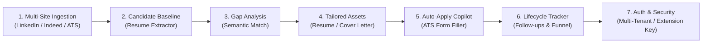

# CLIFF Master Tracker & Engineering Roadmap

This document serves as the single source of truth for the **CLIFF (Career Intelligence & Job Framework)** architecture, decision logs, multi-phase roadmap, and production-grade GCP deployment tasks.

---

## 1. System Vision & Core Objectives

CLIFF is an intelligent, privacy-first career automation platform designed to turn raw job postings and candidate background into high-converting applications through a continuous loop:



1. **Multi-Site Job Ingestion**: Precision extraction from LinkedIn, Indeed, Wellfound, Otta, and direct ATS career sites (Greenhouse, Lever, Ashby, Workday).
2. **Candidate Baseline (Ground Truth)**: PDF/DOCX resume ingestion and structured semantic decomposition (skills, modular experience blocks, education, standard answers).
3. **Semantic Gap Analysis**: Intelligent comparison between job requirements and candidate profile to detect hard gaps, nice-to-haves, and match scores.
4. **Grounded Tailoring**: Selecting and framing real candidate experience blocks (STAR format) matching target keywords without hallucinating credentials.
5. **Auto-Apply Copilot**: In-browser DOM autofill assistant with LLM-generated dynamic Q&A for custom employer questions.
6. **Lifecycle Tracking & Analytics**: Funnel analytics (Saved → Applied → Interview → Offer) and automated follow-up cadences.
7. **Identity, Auth & Multi-Tenancy**: Secure JWT authentication, Chrome extension pairing tokens, and multi-tenant data isolation.

---

## 2. Architecture & GCP Serverless Target Stack

```mermaid
flowchart TD
    subgraph Client Layer
        Ext["Chrome Extension\n(Manifest V3)"]
        UI["React SPA Dashboard\n(Firebase Hosting / Cloud CDN)"]
    end

    subgraph GCP Serverless Compute
        CR["Cloud Run Service\n(FastAPI Core API)"]
        CRF1["Cloud Run Function: fn-parse-resume\n(Eventarc Trigger on GCS)"]
        CRF2["Cloud Run Function: fn-async-scrape\n(Cloud Tasks Trigger)"]
    end

    subgraph GCP Data & Storage
        CSQL[("Cloud SQL PostgreSQL 16\nJSONB + pgvector")]
        GCS[("Cloud Storage Buckets\nv4 Signed URLs for Direct Upload")]
        CT["Cloud Tasks / PubSub\n(Async Queue)"]
        SM["Secret Manager\n(IAM-secured Secrets)"]
    end

    subgraph AI / Foundation Models
        VAI["Vertex AI / Gemini 2.5 Flash\n(IAM / ADC Auth - No hardcoded keys)"]
    end

    Ext -->|POST /api/jobs| CR
    UI -->|GET/PUT API| CR
    UI -->|Direct Upload via Signed URL| GCS
    GCS -.->|Eventarc: object.finalized| CRF1
    CR -->|Enqueue Task| CT
    CT -->|HTTP Trigger| CRF2
    CR -->|Cloud SQL Connector / Unix Socket| CSQL
    CRF1 -->|Save Parsed Profile| CSQL
    CRF2 -->|Save Parsed JD| CSQL
    CR -->|google.auth.default()| VAI
    CRF1 -->|google.auth.default()| VAI
    CR -->|Fetch DB Credentials| SM
```

| Area | Production Decision (GCP Native) | Rationale | Status |
| :--- | :--- | :--- | :--- |
| **Primary Compute** | **Google Cloud Run (Container)** | Serverless, auto-scales to zero when idle, multi-concurrency (up to 250 requests/instance), pay-per-use. | **Accepted** |
| **Event / Background Workers** | **Cloud Run functions (2nd Gen)** | Native Eventarc triggers on GCS file uploads and Cloud Tasks queue invocations. Zero persistent server cost. | **Accepted** |
| **Database Architecture** | **Cloud SQL for PostgreSQL 16 (`pgvector`)** | Full relational integrity + native `JSONB` for schema-less scrapes + `pgvector` for embedding search. Connects via Cloud SQL Auth Proxy or Unix Socket. | **Accepted** |
| **File Storage** | **Google Cloud Storage (GCS) v4 Signed URLs** | Direct browser-to-bucket upload via presigned `PUT` URLs. Eliminates memory exhaustion on API instances. | **Accepted** |
| **AI / Model Provider** | **Vertex AI / Gemini 2.5 Flash** | Native IAM authentication using Application Default Credentials (`google-auth`). No API keys hardcoded in `.env`. | **Accepted** |
| **Task Queue** | **Google Cloud Tasks** | Managed rate-limited async dispatch for scraping and re-scoring with automated retry backoff. | **Accepted** |
| **Secrets Management** | **Google Secret Manager** | Mounts database passwords and JWT signing keys securely into Cloud Run at runtime. | **Accepted** |
| **Authentication** | **Hybrid Mode (Local-First Bypass + Cloud JWT)** | `AUTH_ENABLED=false` provides friction-free zero-config local desktop operation; `AUTH_ENABLED=true` enables multi-tenant SaaS with JWTs and Extension API keys. | **Accepted** |

---

## 3. Multi-Phase Feature Roadmap & Milestones

### Phase 1: LinkedIn Ingestion & Pipeline Management
- [x] LinkedIn job scraper scoping (resolved search counter vs. single job detail pane).
- [x] Canonical URL resolution (`currentJobId` query parameter mapping).
- [x] Extraction of Mode of Work (`Remote` / `Hybrid` / `On-site`).
- [x] Extraction of Recruiter / Hiring Team details and Easy Apply flags.
- [x] In-place SQLite upsert logic to preserve application status and notes.
- [x] Kanban Board with Mode of Work filter pills and live auto-polling.
- [x] Structured backend logging across `/api/jobs`.

### Phase 2: Resume Ingestion & Baseline Candidate Extraction
- [x] **P2.1**: Add `pypdf` / `python-docx` text extraction utilities in backend.
- [x] **P2.2**: Define structured candidate profile schema (Contact, Core Skills, Tooling, Modular Experience Blocks, Education).
- [x] **P2.3**: Implement LLM/SLM structured extraction prompt with strict JSON output & heuristic fallback.
- [x] **P2.4**: Create `POST /api/profile/upload-resume` endpoint with automatic job re-scoring.
- [x] **P2.5**: Build drag-and-drop file upload UI in [`ProfileManager.jsx`](file:///home/dipes/projects/CLIFF/frontend/src/components/ProfileManager.jsx) with real-time extraction progress and modular experience blocks preview.

### Phase 3: Multi-Job Site Support & Universal Scraper
- [ ] **P3.1: Top Tech Platforms**: Indeed, Wellfound (AngelList), Otta, Y Combinator.
- [ ] **P3.2: Direct ATS Job Boards**: Greenhouse, Lever, Ashby, Workday.
- [ ] **P3.3: Universal Career Page Fallback**: Schema.org JSON-LD + SLM readability parser.
- [ ] **P3.4: Source Attribution**: Platform badges and filter pills on Kanban cards.

### Phase 4: Semantic Gap Analysis & Skill Taxonomy
- [ ] **P4.1**: Semantic skill comparison (mapping synonyms like *"Postgres"* to *"Relational Databases"*).
- [ ] **P4.2**: Separation of Hard Requirements vs. Nice-to-Have Pluses.
- [ ] **P4.3**: Automated generation of "Bridge Strategies" and interview talking points for detected skill gaps.
- [ ] **P4.4**: Visual Gap Analysis radar/breakdown inside [`JobDetailModal.jsx`](file:///home/dipes/projects/CLIFF/frontend/src/components/JobDetailModal.jsx).

### Phase 5: Grounded Resume & Pitch Tailoring
- [ ] **P5.1**: Algorithm to score and select candidate experience bullets matching parsed job requirements.
- [ ] **P5.2**: Keyword vocabulary alignment preserving strictly factual claims.
- [ ] **P5.3**: Recruiter InMail & Cold DM personalization leveraging extracted hiring manager details.
- [ ] **P5.4**: Clean PDF resume export via Typst / HTML-to-PDF template.

### Phase 6: Browser Auto-Apply Copilot
- [ ] **P6.1**: DOM form field detector for Workday, Greenhouse, Lever, and Ashby.
- [ ] **P6.2**: Automatic mapping of candidate identity and modular employment history.
- [ ] **P6.3**: In-flight LLM question-answering assistant for dynamic recruiter prompts (salary, sponsorship, motivation).
- [ ] **P6.4**: Floating action bar on job applications with 1-click fill and review.

### Phase 7: Application Lifecycle & Interview Tracking
- [ ] **P7.1**: Ghosting detector & follow-up scheduler (flags applications with no activity after 7/14 days).
- [ ] **P7.2**: Personalized follow-up email / InMail generator for pending applications.
- [ ] **P7.3**: Interview Funnel Metrics (Application-to-Interview conversion rate, time-to-first-response).

### Phase 8: Authentication, Multi-Tenancy & Extension Security
- [ ] **P8.1**: Core Auth & Sessions (bcrypt, JWT access & refresh token rotation).
- [ ] **P8.2**: Chrome Extension Pairing & Auth Handshake.
- [ ] **P8.3**: Multi-Tenant Data Isolation (`user_id` foreign keys and scoped queries).
- [ ] **P8.4**: Hybrid Mode Architecture (`AUTH_ENABLED=false` local / `true` cloud).
- [ ] **P8.5**: Social OAuth (Google / GitHub / LinkedIn).

---

## 4. Production-Grade Hardening Checklist (Per Phase on GCP)

### Phase 1 & Foundation: Cloud SQL (PostgreSQL) & Cloud Run Containerization
- [x] **GCP-1.1: Cloud SQL for PostgreSQL 16 Setup (Terraform IaC & Pure PostgreSQL Architecture)**:
  - [x] Provision Cloud SQL instance with `pgvector` and `JSONB` support via [`terraform/database.tf`](file:///home/dipes/projects/CLIFF/terraform/database.tf).
  - [x] Implement Cloud SQL Unix socket connectivity (`/cloudsql/<INSTANCE_CONNECTION_NAME>`) in [`backend/database.py`](file:///home/dipes/projects/CLIFF/backend/database.py) with production pool recycling (`pool_size=5`, `max_overflow=10`, `pool_pre_ping=True`, `pool_recycle=1800`).
  - [x] Migrated engine entirely to PostgreSQL: deleted local `cliff.db`, removed SQLite PRAGMA migrations, and standardized on PostgreSQL connection pooling and `CREATE EXTENSION IF NOT EXISTS vector;`.
- [ ] **GCP-1.2: Database Migrations with Alembic**:
  - Initialize Alembic migration scripts to automate table creation and schema changes in Cloud SQL during deployment.
- [x] **GCP-1.3: Cloud Run Dockerfile & Container Registry**:
  - [x] Multi-stage production [`backend/Dockerfile`](file:///home/dipes/projects/CLIFF/backend/Dockerfile) with non-root security context (`appuser`), healthcheck probe, and multi-worker Uvicorn.
  - [x] Added [`backend/.dockerignore`](file:///home/dipes/projects/CLIFF/backend/.dockerignore).
  - [x] Provisioned Google Artifact Registry repository (`cliff-repo`) via [`terraform/artifact_registry.tf`](file:///home/dipes/projects/CLIFF/terraform/artifact_registry.tf).
  - [x] Configured Google official bootstrap image (`us-docker.pkg.dev/cloudrun/container/hello`) for zero-dependency first-run Terraform provisioning with lifecycle image protection.
- [x] **GCP-1.4: Google Secret Manager Integration (Terraform IaC)**:
  - [x] Provision Secret Manager secret for database credentials via [`terraform/secrets.tf`](file:///home/dipes/projects/CLIFF/terraform/secrets.tf).
  - [x] Secure IAM access binding (`roles/secretmanager.secretAccessor`) for the Cloud Run Service Account.
  - [x] Mount secret directly into the Cloud Run v2 container specification via [`terraform/cloud_run.tf`](file:///home/dipes/projects/CLIFF/terraform/cloud_run.tf).
- [x] **GCP-1.5: Automated GitOps Infrastructure CI/CD (GitHub Actions)**:
  - [x] Remote GCS backend configured in [`terraform/main.tf`](file:///home/dipes/projects/CLIFF/terraform/main.tf) (`cliff-tfstate-cliff-512020`) for persistent state locking.
  - [x] Automated workflow in [`.github/workflows/deploy-infra.yml`](file:///home/dipes/projects/CLIFF/.github/workflows/deploy-infra.yml) executing `terraform fmt`, `terraform init`, state bootstrapping/seeding, and automated `terraform apply` on merge to `main`.
  - [x] Concurrency locking (`terraform-prod`) to prevent simultaneous conflicting applies.

### Phase 2: Production Document Storage (GCS v4 Signed URLs & Event-Driven Processing)
- [x] **GCP-2.1: Direct-to-GCS Presigned v4 Uploads**:
  - [x] Backend endpoint `POST /api/storage/signed-upload-url` generates a Google Cloud Storage v4 signed `PUT` URL with a 15-minute expiration.
  - [x] React frontend uploads PDF/DOCX directly to `gs://cliff-resumes/{user_id}/{file_uuid}.pdf`.
  - [x] Added `POST /api/profile/process-uploaded-resume` as resilient direct fallback.
- [x] **GCP-2.2: Event-Driven Resume Processing via GCS Notification & Pub/Sub Push**:
  - [x] Defined `google_pubsub_topic.resume_uploaded` and `google_pubsub_topic.resume_analyzed` in [`terraform/pubsub.tf`](file:///home/dipes/projects/CLIFF/terraform/pubsub.tf).
  - [x] Configured `google_storage_notification.resume_upload_notification` to emit `OBJECT_FINALIZE` on `resumes/` prefix.
  - [x] Push subscription delivers events with OIDC token to `/api/internal/events/resume-uploaded`.
  - [x] Implemented `ResumeUploadTask` database tracking and frontend short-polling on `/api/profile/upload-status/{task_id}`.
- [x] **GCP-2.3: GCS Lifecycle Policy (Terraform IaC)**:
  - [x] Automated 90-day Coldline transition and 30-day non-current version deletion configured in [`terraform/storage.tf`](file:///home/dipes/projects/CLIFF/terraform/storage.tf).
  - [x] Bucket-level CORS rules enabled for `PUT`, `GET`, `OPTIONS`, `Content-Type`, and `x-goog-resumable`.


### Phase 3: High-Throughput Scraper & Cloud Tasks
- [ ] **GCP-3.1: Cloud Tasks Async Queue**:
  - Extension sends job to `POST /api/jobs`; API enqueues a message in Google Cloud Tasks and immediately responds `202 Accepted` (<50ms).
- [ ] **GCP-3.2: Cloud Run Function for Job Extraction (`fn-async-scrape`)**:
  - Triggered by Cloud Tasks HTTP webhook.
  - Runs SLM/Gemini extraction on the raw job description, checks candidate skills from Cloud SQL, and writes `Job` and `JobIntelligence` records.

### Phase 4: Production Vertex AI (Gemini Flash) with IAM Authentication
- [x] **GCP-4.1: IAM Service Account Authentication (Terraform IaC)**:
  - [x] Dedicated service account `cliff-app-sa` provisioned in [`terraform/iam.tf`](file:///home/dipes/projects/CLIFF/terraform/iam.tf).
  - [x] Bound `roles/aiplatform.user`, `roles/cloudsql.client`, `roles/storage.objectAdmin`, and `roles/iam.serviceAccountTokenCreator`.
  - [x] Implemented keyless Vertex AI (`genai.Client(vertexai=True, ...)`) in [`backend/ai_engine.py`](file:///home/dipes/projects/CLIFF/backend/ai_engine.py) with IAM Application Default Credentials, eliminating API key dependencies.
- [ ] **GCP-4.2: Rate-Limit Resilience & Token Quotas**:
  - Implement exponential backoff for Vertex AI API rate quotas.
  - Track token consumption per candidate in Cloud SQL for cost accounting.
- [ ] **GCP-4.3: Semantic Search with `pgvector`**:
  - Use Vertex AI `text-embedding-004` to generate 768-dim embeddings for job descriptions and candidate skills.
  - Query Cloud SQL using HNSW index cosine distance (`<=>`).

### Phase 5: Production Resume Tailoring & Document Generation
- [ ] **GCP-5.1: Headless Typst PDF Compilation**:
  - Package Typst in a Cloud Run service or function. Compiles tailored JSON directly into high-fidelity ATS PDFs.
  - Save tailored PDFs to `gs://cliff-tailored-resumes/{user_id}/{job_id}.pdf` with signed download URLs.

### Phase 6: Chrome Extension Production Hardening
- [ ] **GCP-6.1: Chrome Web Store Security & Packaging**:
  - Enforce `chrome.storage.session` for in-memory session protection.
  - Cloud Run HTTPS endpoint configuration with custom domain mapping (`api.cliff.dev`).
  - Scoped extension pairing API tokens.

### Phase 7: Observability (Cloud Logging & Cloud Monitoring)
- [ ] **GCP-7.1: Google Cloud Logging & Trace**:
  - Structured JSON logging parsed natively by Cloud Logging (`severity`, `trace`, `spanId`).
  - Cloud Monitoring dashboards tracking Cloud Run latency, 4xx/5xx error rates, and database connection pool saturation.

### Phase 8: Multi-Tenant Auth & Production Security
- [ ] **GCP-8.1: Google Identity Platform / Firebase Auth**:
  - Verify Firebase/Google ID tokens via `firebase-admin` in FastAPI middleware.
  - Row-Level Security (RLS) in Cloud SQL ensuring strict tenant isolation.

---

## 5. Infrastructure-as-Code (Terraform) Status & Resolution Log

| Component | Target File | Status | Notes |
| :--- | :--- | :--- | :--- |
| **GCP Providers & APIs** | [`terraform/main.tf`](file:///home/dipes/projects/CLIFF/terraform/main.tf) | **Ready** | Enables 10 core APIs: Cloud Run, Cloud SQL Admin, Storage, Secret Manager, Vertex AI, IAM Credentials, Artifact Registry, Cloud Tasks, Eventarc, Cloud Build. |
| **Artifact Registry** | [`terraform/artifact_registry.tf`](file:///home/dipes/projects/CLIFF/terraform/artifact_registry.tf) | **Ready** | Dedicated Docker repository `cliff-repo` for container builds. |
| **GCS Buckets & CORS** | [`terraform/storage.tf`](file:///home/dipes/projects/CLIFF/terraform/storage.tf) | **Ready** | Provisions `cliff-resumes` & `cliff-tailored` with client-to-storage CORS, versioning, and Coldline lifecycle. |
| **Cloud SQL PostgreSQL 16** | [`terraform/database.tf`](file:///home/dipes/projects/CLIFF/terraform/database.tf) | **Ready** | Automated DB password generation, custom tier, SSD autoscaling, query insights. |
| **IAM Service Accounts** | [`terraform/iam.tf`](file:///home/dipes/projects/CLIFF/terraform/iam.tf) | **Ready** | Least-privilege `cliff-app-sa` with Token Creator and AI Platform User + Cloud Build Artifact Registry Writer. |
| **Secret Manager** | [`terraform/secrets.tf`](file:///home/dipes/projects/CLIFF/terraform/secrets.tf) | **Ready** | Auto-managed DB credentials secret with accessor role binding. |
| **Cloud Run v2 Service** | [`terraform/cloud_run.tf`](file:///home/dipes/projects/CLIFF/terraform/cloud_run.tf) | **Ready** | Cloud SQL Unix socket mount (`/cloudsql`), Secret Manager env resolution, scale-to-zero, lifecycle image protection. |

### Resolved Deployment Issues

1. **Terraform Local Syntax Error (`main.tf`)**:
   - *Issue*: `for_each = toset(locals.services)` caused `Reference to undeclared resource "locals"` error.
   - *Fix*: Changed to singular `local.services` in [`terraform/main.tf`](file:///home/dipes/projects/CLIFF/terraform/main.tf#L45).
2. **Cloud SQL Unsupported Flag Error (`database.tf`)**:
   - *Issue*: Cloud SQL API rejected `cloudsql.enable_pgvector = "on"` with `Error 404: The requested flag is either misspelled or unsupported by Cloud SQL (invalidFlagName)`.
   - *Fix*: Removed flag block in [`terraform/database.tf`](file:///home/dipes/projects/CLIFF/terraform/database.tf#L21-L24). Cloud SQL PostgreSQL 15 & 16 bundle `pgvector` natively without needing GCP instance-level flags. The extension is activated directly in SQL via `CREATE EXTENSION IF NOT EXISTS vector;`.
3. **`gcloud` ADC OAuth Scope Conflict**:
   - *Issue*: `gcloud auth application-default login` crashed with `Scope has changed from ... to ...` due to stale cached tokens in `~/.config/gcloud/`.
   - *Fix*: Authenticated using explicit scope: `gcloud auth application-default login --scopes=https://www.googleapis.com/auth/cloud-platform`.
4. **Cloud Run Missing Image on Bootstrap**:
   - *Issue*: Initial `terraform apply` failed because custom image `cliff-backend:latest` had not yet been built.
   - *Fix*: Defaulted `backend_image` in [`terraform/variables.tf`](file:///home/dipes/projects/CLIFF/terraform/variables.tf) to Google's official bootstrap image `us-docker.pkg.dev/cloudrun/container/hello` and added `lifecycle { ignore_changes = [template[0].containers[0].image] }` in [`terraform/cloud_run.tf`](file:///home/dipes/projects/CLIFF/terraform/cloud_run.tf).
5. **Cloud Build Permission Denied on First Submit**:
   - *Issue*: `gcloud builds submit` failed with `PERMISSION_DENIED` right after enabling `cloudbuild.googleapis.com`.
   - *Fix*: Added `roles/cloudbuild.builds.editor` and `roles/storage.admin` to caller identity and automated `roles/artifactregistry.writer` for the Cloud Build service account in [`terraform/iam.tf`](file:///home/dipes/projects/CLIFF/terraform/iam.tf).
6. **Cloud Run Container Startup & Port Binding**:
   - *Issue*: Cloud Run reported `container failed to start and listen on the port defined provided by the PORT=8080 environment variable`.
   - *Fix*:
     - Updated [`backend/Dockerfile`](file:///home/dipes/projects/CLIFF/backend/Dockerfile) to use standard `/opt/venv` architecture with `libpq5` and bound `$PORT` dynamically via `CMD ["sh", "-c", "exec uvicorn main:app --host 0.0.0.0 --port ${PORT:-8080} --workers 2"]`.
     - Added `psycopg2-binary>=2.9.9` to [`backend/requirements.txt`](file:///home/dipes/projects/CLIFF/backend/requirements.txt).
     - Enhanced [`backend/database.py`](file:///home/dipes/projects/CLIFF/backend/database.py) to automatically connect to Cloud SQL PostgreSQL via `/cloudsql/<INSTANCE_CONNECTION_NAME>` Unix socket with connection pool pre-pinging and recycling, while keeping offline SQLite fallback.
     - Hardened [`backend/main.py`](file:///home/dipes/projects/CLIFF/backend/main.py) lifespan with try/except guards so startup never crashes unhandled.
